I am a front-end developer and web designer based in Aktobe, Kazakhstan, and a student at K. Zhubanov Aktobe Regional University.

I design and build clean, fast and accessible interfaces, taking products from a Figma mockup to a production-ready React application. My recent work focuses on AI-powered education tools and offline-first web apps.

       
 
       

  
  
  
  

| Event | Result |
| :-- | :-- |
| **Decentrathon 6.0** | Hackathon participant, Qazaq Loc QA case |
| **ICPC** | Contestant, International Collegiate Programming Contest |

  

