 

## 👋 About me · Обо мне

<table>
<tr>
<td width="50%" valign="top">

**English**

I'm **Bekzhan**, a front-end developer and web designer from **Aktobe, Kazakhstan**, and a student at **K. Zhubanov Aktobe Regional University**.

I build clean, fast and responsive interfaces, from a Figma mockup to a production-ready React application.

- 💻 Building UIs with **React, TypeScript and Tailwind CSS**
- 🧠 Working on AI-powered EdTech products
- 🏆 Hackathon participant and **ICPC** contestant
- 🤝 **Open to work:** full-time, internships, freelance and collaborations

</td>
<td width="50%" valign="top">

**Русский**

Меня зовут **Бекжан**, я фронтенд-разработчик и веб-дизайнер из **Актобе (Казахстан)**, студент **Актюбинского регионального университета имени К. Жубанова**.

Создаю чистые, быстрые и адаптивные интерфейсы: от макета в Figma до готового React-приложения.

- 💻 Разрабатываю интерфейсы на **React, TypeScript и Tailwind CSS**
- 🧠 Работаю над EdTech-продуктами с искусственным интеллектом
- 🏆 Участник хакатонов и олимпиады **ICPC**
- 🤝 **Открыт к работе:** полная занятость, стажировки, фриланс и совместные проекты

</td>
</tr>
</table>

## 🛠 Tech stack · Технологии

**Front-end**

        

**Back-end & tools**

      

**Design**

  

## 🚀 Projects · Проекты

| Project | Description | Описание | Stack |
| :-- | :-- | :-- | :-- |
| [**Fill AI**](https://github.com/b-beka/fill-ai) | Real-time AI copilot for online lectures: turns a live lesson into a summary, quizzes and flashcards | AI-помощник для онлайн-лекций: в реальном времени превращает занятие в конспект, задания и карточки | React · TypeScript · Tailwind · FastAPI |
| [**Kaytadan**](https://github.com/b-beka/Kaytadan) | Offline-first flashcards with spaced repetition, installable as a PWA | Карточки для запоминания слов с интервальным повторением; работают офлайн и устанавливаются как PWA | React · TypeScript · Vite · Dexie |
| [**HomePrise**](https://github.com/b-beka/HomePrise) | Website for predicting house prices | Сайт для прогнозирования цен на жильё | HTML · CSS · JavaScript |
| **Qazaq Loc QA** | Quality checks for Kazakh localization of Flutter ARB files | Проверка качества казахской локализации Flutter-приложений (ARB) | Python |

## 🏆 Achievements · Достижения

- **Decentrathon 6.0** — hackathon participant, Qazaq Loc QA case · участник хакатона, кейс Qazaq Loc QA
- **ICPC** — competitive programming contestant · участник олимпиады по спортивному программированию

## 📊 GitHub stats · Статистика

---

**Open to job offers, internships, freelance and collaborations.** 
**Открыт к предложениям о работе, стажировкам, фрилансу и сотрудничеству.**

