  

 

I am a front-end developer and web designer based in Aktobe, Kazakhstan, and a student at K. Zhubanov Aktobe Regional University.

I design and build clean, fast and accessible interfaces, taking products from a Figma mockup to a production-ready React application. My recent work focuses on AI-powered education tools and offline-first web apps.

- Building user interfaces with React, TypeScript and Tailwind CSS
- Developing AI-powered EdTech products
- Hackathon participant and ICPC contestant
- Open to full-time roles, internships, freelance work and collaborations

 

 

  
  
  
  

 

 

 

  
  
  

