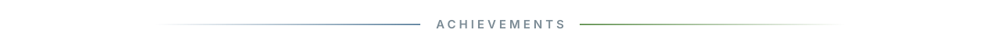
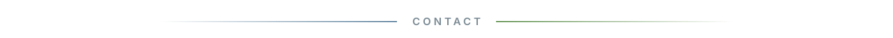

<picture><source media="(prefers-color-scheme: dark)" srcset="./assets/dark/header.svg"></picture>

<picture><source media="(prefers-color-scheme: dark)" srcset="./assets/dark/title-about.svg"></picture>

I am Tlektes Bekzhan, a front-end developer and web designer based in Aktobe, Kazakhstan, and a student at K. Zhubanov Aktobe Regional University.

I design and build clean, fast and accessible interfaces, taking products from a Figma mockup to a production-ready React application. My recent work focuses on AI-powered education tools and offline-first web apps.

<picture><source media="(prefers-color-scheme: dark)" srcset="./assets/dark/title-stack.svg"></picture>

<picture><source media="(prefers-color-scheme: dark)" srcset="./assets/dark/stack.svg"></picture>

<picture><source media="(prefers-color-scheme: dark)" srcset="./assets/dark/title-projects.svg"></picture>

  <a href="https://github.com/b-beka/fill-ai"><picture><source media="(prefers-color-scheme: dark)" srcset="./assets/dark/card-fill-ai.svg"></picture></a>
  <a href="https://github.com/b-beka/Kaytadan"><picture><source media="(prefers-color-scheme: dark)" srcset="./assets/dark/card-kaytadan.svg"></picture></a>
  <a href="https://github.com/b-beka/HomePrise"><picture><source media="(prefers-color-scheme: dark)" srcset="./assets/dark/card-homeprise.svg"></picture></a>
  <picture><source media="(prefers-color-scheme: dark)" srcset="./assets/dark/card-qazaq-loc-qa.svg"></picture>

<picture><source media="(prefers-color-scheme: dark)" srcset="./assets/dark/title-achievements.svg"></picture>

| Event | Result |
| :-- | :-- |
| **Decentrathon 6.0** | Hackathon participant, Qazaq Loc QA case |
| **ICPC** | Contestant, International Collegiate Programming Contest |

<picture><source media="(prefers-color-scheme: dark)" srcset="./assets/dark/title-activity.svg"></picture>

<picture><source media="(prefers-color-scheme: dark)" srcset="./assets/dark/stats.svg"></picture>

<picture><source media="(prefers-color-scheme: dark)" srcset="./assets/dark/title-contact.svg"></picture>

  

<picture><source media="(prefers-color-scheme: dark)" srcset="./assets/dark/footer.svg"></picture>
